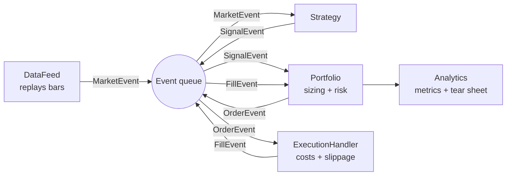
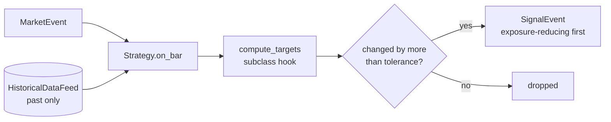

# QuantLab Architecture

## Event loop

The queue is drained after every bar, so a strategy can only react to data that has already been
published. Orders placed on bar *t* fill no earlier than bar *t+1*.

## Components and delivery schedule

| Component | Module(s) | Day |
|-----------|-----------|-----|
| Data validation, loaders, synthetic markets | `quantlab.data` | 1 (done) |
| Return and annualisation utilities | `quantlab.utils` | 1 (done) |
| Events, queue, data feed, portfolio | `quantlab.events`, `quantlab.feed`, `quantlab.portfolio` | 2 (done) |
| Strategy interface and strategies | `quantlab.strategy`, `quantlab.testing` | 3 (done) |
| Execution, cost models and the engine | `quantlab.execution`, `quantlab.engine` | 4 (done) |
| Performance and risk analytics | `quantlab.analytics` | 5 (done) |
| Research tooling | `quantlab.research` | 6 |
| Reporting and CLI | `quantlab.report`, `quantlab.cli` | 7 |

## Key design decisions

1. **Single-instrument frames, panel helpers.** The unit of storage is one validated OHLCV frame per
   symbol; `to_close_panel` builds wide views when a cross-sectional strategy needs them.
2. **Costs are a model, not a constant.** Day 4 makes commission, slippage and market impact
   pluggable, since backtested edge often disappears once costs are realistic.
3. **Analytics are pure functions.** Metrics take a return series and return numbers, so they are
   trivially testable and reusable outside the engine.

## Strategy contract (Day 3)

* A strategy returns *target weights*; it never sees cash, prices-to-trade or order sizes.
* The base class de-duplicates unchanged targets and emits exposure-reducing signals first, so a
  leverage cap in the portfolio cannot block a rebalance that would have freed capacity.
* `VolTargetAllocation` rebalances all-or-nothing (a band on the whole weight vector), so the
  held weights are always one complete target and never a blend that could breach the cap.
* Lookahead protection is two-layered: the feed cannot return future bars, and a truncation test
  proves each strategy's decisions are unchanged when later data is removed.
